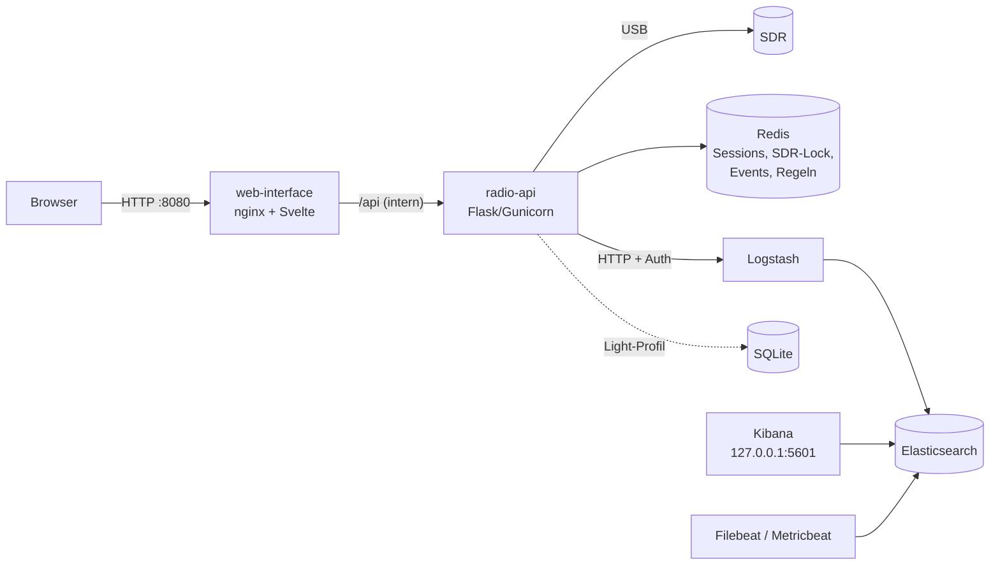

# RadioMoni

Funküberwachung mit Software Defined Radio: aufnehmen, dekodieren, transkribieren, durchsuchen und alarmieren. Das Ganze läuft als Docker-Stack mit Weboberfläche, REST-API und optional mit Elasticsearch/Kibana.

[](https://github.com/defendeggu/Radio-Monitoring/actions/workflows/ci.yml)

[](LICENSE)

## Funktionen

- **Sprache:** FM/AM/SSB aufnehmen und mit [faster-whisper](https://github.com/SYSTRAN/faster-whisper) transkribieren, auf CPU oder NVIDIA-GPU
- **VOX-Aufnahme:** einen Kanal dauerhaft überwachen. Aufgenommen und transkribiert wird nur, wenn jemand sendet.
- **APRS und POCSAG:** als Einzelaufnahme oder im 24/7-Streaming, APRS-Stationen auf einer Karte, Maidenhead-Locator
- **ADS-B, AIS, ISM-Sensoren:** Flugzeuge (readsb), Schiffe (rtl_ais) und Funksensoren (rtl_433) mit einem RTL-SDR
- **Repeater-Scan:** Aktivität der Schweizer FM-Relais messen
- **Multi-Channel (USRP N200):** bis zu 8 Kanäle aus einem Breitband-Strom gleichzeitig dekodieren
- **Alarme:** Rufzeichen, Pager-Adressen oder Stichworte melden, per ntfy, Telegram, Webhook oder E-Mail
- **Zeitpläne, Lesezeichen, Export:** Cron-Jobs, Frequenz-Presets, CSV/GeoJSON/KML/ZIP
- **Live-Weboberfläche** (Svelte) mit Dashboard, Server-Sent Events und dokumentierter REST-API (OpenAPI 3.1)

## Unterstützte Hardware

| Gerät | Frequenzbereich | Hinweise |
|---|---|---|
| RTL-SDR (v3/v4) | 24 MHz – 1.766 GHz | einziges Gerät für ADS-B, AIS und ISM-Sensoren |
| HackRF One | 1 MHz – 6 GHz | min. 2 MS/s; lange Aufnahmen besser mit RTL-SDR |
| Airspy HF+ | 0.5 kHz – 31 MHz, 60 – 260 MHz | Kurzwelle |
| Ettus USRP N200 (WBX) | 50 MHz – 2.2 GHz | über Gigabit-Ethernet; Image mit `WITH_USRP=1` bauen |

Details, udev-Regeln, PPM-Korrektur und Fehlerbehebung: [docs/hardware.md](docs/hardware.md).

## Schnellstart (Docker)

Voraussetzungen: Docker mit Compose v2, etwa 6 GB RAM für den Vollausbau (Light-Profil: etwa 2 GB).

```bash
git clone https://github.com/defendeggu/Radio-Monitoring.git && cd Radio-Monitoring
./scripts/setup-env.sh              # erzeugt .env mit zufälligen Secrets und zeigt den API-Key
docker compose up -d --build        # Stack bauen und starten
./scripts/post-docker-setup.sh      # Elasticsearch-Benutzer, Templates, Kibana-Dashboards
./scripts/run_import.sh             # optional: Schweizer Repeater-Liste importieren
```

Danach im Browser **http://localhost:8080** öffnen und unter *Einstellungen* den API-Key eintragen.

**Light-Profil** (ohne ELK, Daten in SQLite, z. B. für einen Raspberry Pi):

```bash
./scripts/setup-env.sh --light && docker compose up -d --build
```

**GPU** für Whisper (NVIDIA mit Container Toolkit):

```bash
docker compose -f docker-compose.yml -f docker-compose.gpu.yml up -d --build
```

## Architektur



- Veröffentlicht ist nur die Weboberfläche. API, Redis, Elasticsearch und Logstash sind ausschliesslich im Docker-Netz erreichbar, Kibana nur auf `localhost`.
- Eine SDR-Sperre in Redis verhindert, dass zwei Jobs gleichzeitig auf das Gerät zugreifen. Ein zweiter Job bekommt sofort *HTTP 409*.
- Jedes dekodierte Paket wird gespeichert, live an die Oberfläche geschickt und gegen die Alarmregeln geprüft.

## Dokumentation

| Thema | Datei |
|---|---|
| Installation, Profile, GPU, Update | [docs/installation.md](docs/installation.md) |
| Alle Einstellungen (`.env`) | [docs/configuration.md](docs/configuration.md) |
| Hardware, Treiber, Fehlerbehebung | [docs/hardware.md](docs/hardware.md) |
| Bedienung der Weboberfläche | [docs/usage.md](docs/usage.md) |
| REST-API, Beispiele, Live-Events | [docs/api.md](docs/api.md) |
| Sicherheit | [docs/security.md](docs/security.md) |
| Elasticsearch, Kibana, Backup | [docs/elk.md](docs/elk.md) |
| Entwicklung und Tests | [docs/development.md](docs/development.md) |
| Upgrade von 3.x auf 4.0 | [docs/upgrade-4.0.md](docs/upgrade-4.0.md) |
| Änderungen | [CHANGELOG.md](CHANGELOG.md) · [ROADMAP.md](ROADMAP.md) |

## Rechtlicher Hinweis

Die Software empfängt nur, sie sendet nicht. Beachte die Gesetze deines Landes. In der Schweiz gilt das Fernmeldegesetz: Nicht für dich bestimmte Inhalte (z. B. Pager-Meldungen von Blaulicht-Organisationen) darfst du nicht weitergeben oder verwerten. Verschlüsselte Kommunikation darfst du nicht entschlüsseln. Für Aufbewahrung und Export der Daten bist du selbst verantwortlich.

## Lizenz und Credits

Code: MIT – created by Adrian S. and Anthropic Claude
