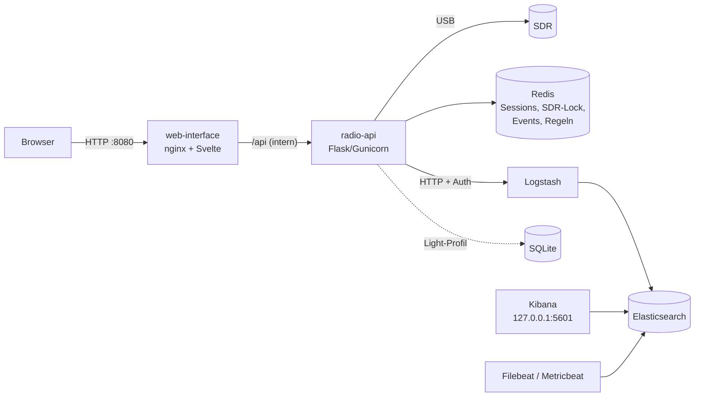
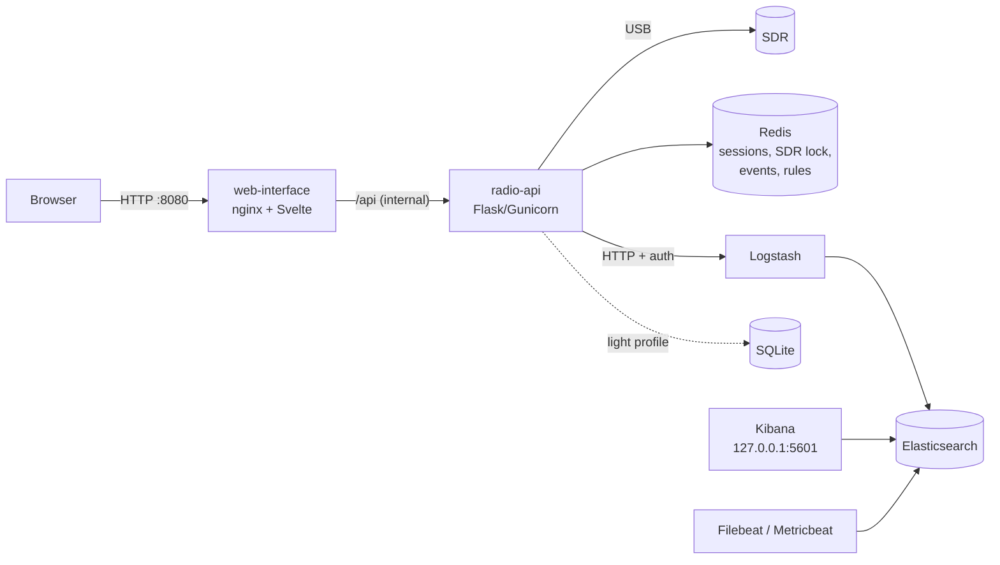

# RadioMoni

🇬🇧 **[English Version](#english-version)** below

Funküberwachung mit Software Defined Radio: aufnehmen, dekodieren, transkribieren, durchsuchen und alarmieren. Das Ganze läuft als Docker-Stack mit Weboberfläche, REST-API und optional mit Elasticsearch/Kibana.

[](https://github.com/defendeggu/Radio-Monitoring/actions/workflows/ci.yml)
[](CHANGELOG.md)
[](LICENSE)

## Funktionen

- **Sprache:** FM/AM/SSB aufnehmen und mit [faster-whisper](https://github.com/SYSTRAN/faster-whisper) transkribieren, auf CPU oder NVIDIA-GPU
- **VOX-Aufnahme:** einen Kanal dauerhaft überwachen. Aufgenommen und transkribiert wird nur, wenn jemand sendet.
- **APRS und POCSAG:** als Einzelaufnahme oder im 24/7-Streaming, APRS-Stationen auf einer Karte, Maidenhead-Locator
- **ADS-B, AIS, ISM-Sensoren:** Flugzeuge (readsb, RTL-SDR oder HackRF), Schiffe (rtl_ais) und Funksensoren (rtl_433) mit einem RTL-SDR
- **Repeater-Scan:** Aktivität der Schweizer FM-Relais messen
- **Multi-Channel (USRP N200):** bis zu 8 Kanäle aus einem Breitband-Strom gleichzeitig dekodieren
- **Alarme:** Rufzeichen, Pager-Adressen oder Stichworte melden, per ntfy, Telegram, Webhook oder E-Mail
- **Zeitpläne, Lesezeichen, Export:** Cron-Jobs, Frequenz-Presets, CSV/GeoJSON/KML/ZIP
- **Live-Weboberfläche** (Svelte, Deutsch/Englisch) mit Dashboard, Server-Sent Events und dokumentierter REST-API (OpenAPI 3.1)

## Unterstützte Hardware

| Gerät | Frequenzbereich | Hinweise |
|---|---|---|
| RTL-SDR (v3/v4) | 24 MHz – 1.766 GHz | einziges Gerät für AIS und ISM-Sensoren |
| HackRF One | 1 MHz – 6 GHz | min. 2 MS/s; auch ADS-B; lange Aufnahmen besser mit RTL-SDR |
| Airspy HF+ | 0.5 kHz – 31 MHz, 60 – 260 MHz | Kurzwelle |
| Ettus USRP N200 (WBX) | 50 MHz – 2.2 GHz | über Gigabit-Ethernet; Image mit `WITH_USRP=1` bauen |

Details, udev-Regeln, PPM-Korrektur und Fehlerbehebung: [docs/hardware.md](docs/hardware.md).

## Schnellstart (Docker)

Voraussetzungen: Docker mit Compose v2, etwa 6 GB RAM für den Vollausbau (Light-Profil: etwa 2 GB).

```bash
git clone https://github.com/defendeggu/Radio-Monitoring.git && cd Radio-Monitoring
./scripts/setup-env.sh              # erzeugt .env mit zufälligen Secrets und zeigt den API-Key
docker compose up -d --build        # Stack bauen und starten
./scripts/post-docker-setup.sh      # Elasticsearch-Benutzer, Templates, Kibana-Dashboards
./scripts/run_import.sh             # optional: Schweizer Repeater-Liste importieren
```

Danach im Browser **http://localhost:8080** öffnen und unter *Einstellungen* den API-Key eintragen.

**Light-Profil** (ohne ELK, Daten in SQLite, z. B. für einen Raspberry Pi):

```bash
./scripts/setup-env.sh --light && docker compose up -d --build
```

**GPU** für Whisper (NVIDIA mit Container Toolkit):

```bash
docker compose -f docker-compose.yml -f docker-compose.gpu.yml up -d --build
```

## Architektur



- Veröffentlicht ist nur die Weboberfläche. API, Redis, Elasticsearch und Logstash sind ausschliesslich im Docker-Netz erreichbar, Kibana nur auf `localhost`.
- Eine SDR-Sperre in Redis verhindert, dass zwei Jobs gleichzeitig auf das Gerät zugreifen. Ein zweiter Job bekommt sofort *HTTP 409*.
- Jedes dekodierte Paket wird gespeichert, live an die Oberfläche geschickt und gegen die Alarmregeln geprüft.

## Dokumentation

| Thema | Datei |
|---|---|
| Installation, Profile, GPU, Update | [docs/installation.md](docs/installation.md) |
| Alle Einstellungen (`.env`) | [docs/configuration.md](docs/configuration.md) |
| Hardware, Treiber, Fehlerbehebung | [docs/hardware.md](docs/hardware.md) |
| Bedienung der Weboberfläche | [docs/usage.md](docs/usage.md) |
| REST-API, Beispiele, Live-Events | [docs/api.md](docs/api.md) |
| Sicherheit | [docs/security.md](docs/security.md) |
| Elasticsearch, Kibana, Backup | [docs/elk.md](docs/elk.md) |
| Entwicklung und Tests | [docs/development.md](docs/development.md) |
| Upgrade von 3.x auf 4.0 | [docs/upgrade-4.0.md](docs/upgrade-4.0.md) |
| Änderungen | [CHANGELOG.md](CHANGELOG.md) · [ROADMAP.md](ROADMAP.md) |

## Rechtlicher Hinweis

Die Software empfängt nur, sie sendet nicht. Beachte die Gesetze deines Landes. In der Schweiz gilt das Fernmeldegesetz: Nicht für dich bestimmte Inhalte (z. B. Pager-Meldungen von Blaulicht-Organisationen) darfst du nicht weitergeben oder verwerten. Verschlüsselte Kommunikation darfst du nicht entschlüsseln. Für Aufbewahrung und Export der Daten bist du selbst verantwortlich.

## Lizenz und Credits

Code: MIT – created by Adrian S. and Anthropic Claude

---

<a id="english-version"></a>

## English Version

Radio monitoring with software defined radio: record, decode, transcribe, search and alert. Everything runs as a Docker stack with a web interface, a REST API and optionally Elasticsearch/Kibana.

### Features

- **Voice:** record FM/AM/SSB and transcribe it with [faster-whisper](https://github.com/SYSTRAN/faster-whisper), on CPU or NVIDIA GPU
- **VOX recording:** monitor a channel continuously. Recording and transcription only happen while someone is transmitting.
- **APRS and POCSAG:** as a single capture or 24/7 streaming, APRS stations on a map, Maidenhead locator
- **ADS-B, AIS, ISM sensors:** aircraft (readsb, RTL-SDR or HackRF), ships (rtl_ais) and wireless sensors (rtl_433) with an RTL-SDR
- **Repeater scan:** measure the activity of Swiss FM repeaters
- **Multi-channel (USRP N200):** decode up to 8 channels simultaneously from one wideband stream
- **Alerts:** report callsigns, pager addresses or keywords via ntfy, Telegram, webhook or e-mail
- **Schedules, bookmarks, export:** cron jobs, frequency presets, CSV/GeoJSON/KML/ZIP
- **Live web interface** (Svelte, German/English) with dashboard, server-sent events and a documented REST API (OpenAPI 3.1)

### Supported hardware

| Device | Frequency range | Notes |
|---|---|---|
| RTL-SDR (v3/v4) | 24 MHz – 1.766 GHz | the only device for AIS and ISM sensors |
| HackRF One | 1 MHz – 6 GHz | min. 2 MS/s; also ADS-B; long recordings work better with an RTL-SDR |
| Airspy HF+ | 0.5 kHz – 31 MHz, 60 – 260 MHz | shortwave |
| Ettus USRP N200 (WBX) | 50 MHz – 2.2 GHz | via Gigabit Ethernet; build the image with `WITH_USRP=1` |

Details, udev rules, PPM correction and troubleshooting: [docs/hardware.md](docs/hardware.md#english-version).

### Quick start (Docker)

Requirements: Docker with Compose v2, about 6 GB RAM for the full stack (light profile: about 2 GB).

```bash
git clone https://github.com/defendeggu/Radio-Monitoring.git && cd Radio-Monitoring
./scripts/setup-env.sh              # creates .env with random secrets and prints the API key
docker compose up -d --build        # build and start the stack
./scripts/post-docker-setup.sh      # Elasticsearch users, templates, Kibana dashboards
./scripts/run_import.sh             # optional: import the Swiss repeater list
```

Then open **http://localhost:8080** in your browser and enter the API key under *Settings*. The web interface is available in German and English (button **EN/DE** in the sidebar).

**Light profile** (no ELK, data in SQLite, e.g. for a Raspberry Pi):

```bash
./scripts/setup-env.sh --light && docker compose up -d --build
```

**GPU** for Whisper (NVIDIA with Container Toolkit):

```bash
docker compose -f docker-compose.yml -f docker-compose.gpu.yml up -d --build
```

### Architecture



- Only the web interface is published. API, Redis, Elasticsearch and Logstash are reachable only inside the Docker network, Kibana only on `localhost`.
- An SDR lock in Redis prevents two jobs from accessing the device at the same time. A second job immediately gets *HTTP 409*.
- Every decoded packet is stored, sent live to the interface and checked against the alert rules.

### Documentation

Each file is written in German first, followed by an English version.

| Topic | File |
|---|---|
| Installation, profiles, GPU, updates | [docs/installation.md](docs/installation.md#english-version) |
| All settings (`.env`) | [docs/configuration.md](docs/configuration.md#english-version) |
| Hardware, drivers, troubleshooting | [docs/hardware.md](docs/hardware.md#english-version) |
| Using the web interface | [docs/usage.md](docs/usage.md#english-version) |
| REST API, examples, live events | [docs/api.md](docs/api.md#english-version) |
| Security | [docs/security.md](docs/security.md#english-version) |
| Elasticsearch, Kibana, backup | [docs/elk.md](docs/elk.md#english-version) |
| Development and tests | [docs/development.md](docs/development.md#english-version) |
| Upgrading from 3.x to 4.0 | [docs/upgrade-4.0.md](docs/upgrade-4.0.md#english-version) |
| Changes | [CHANGELOG.md](CHANGELOG.md) · [ROADMAP.md](ROADMAP.md) |

### Legal notice

The software only receives, it does not transmit. Observe the laws of your country. In Switzerland the Telecommunications Act applies: you may not pass on or make use of content not intended for you (e.g. pager messages of emergency services). You may not decrypt encrypted communication. You are responsible for the retention and export of the data yourself.

### License and credits

Code: MIT – created by Adrian S. and Anthropic Claude
